<div align="center">

<picture>
  <source media="(prefers-color-scheme: dark)" srcset="docs/images/wordmark-dark.svg">
  <source media="(prefers-color-scheme: light)" srcset="docs/images/wordmark-light.svg">
  
</picture>

<h3>Music that plays with its video, remembers what you like and picks what comes next.</h3>

<p>For Android, Windows, Linux and macOS. Free and open source.</p>

<p>
  <a href="https://github.com/Vijay-Janarthanan/cosmotune/releases/latest"></a>
  <a href="https://github.com/Vijay-Janarthanan/cosmotune/releases"></a>
  <a href="LICENSE"></a>
  
  
</p>

<p>
  <a href="#android"></a>
  <a href="#windows"></a>
  <a href="#linux"></a>
  <a href="#macos"></a>
</p>

<picture>
  <source media="(prefers-color-scheme: dark)" srcset="docs/images/hero-dark.webp">
  <source media="(prefers-color-scheme: light)" srcset="docs/images/hero-light.webp">
  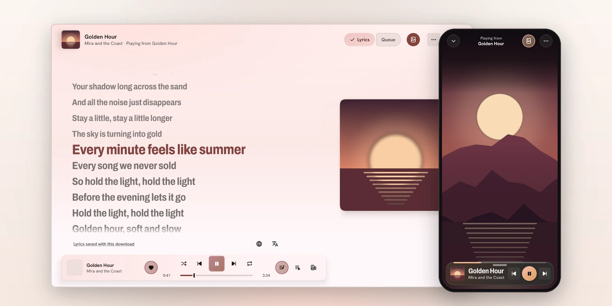
</picture>

<sub>The pictures on this page are the app's own screens, drawn with made-up songs, artists and videos.</sub>

</div>

## Screenshots

<table>
  <tr>
    <td align="center" width="33%">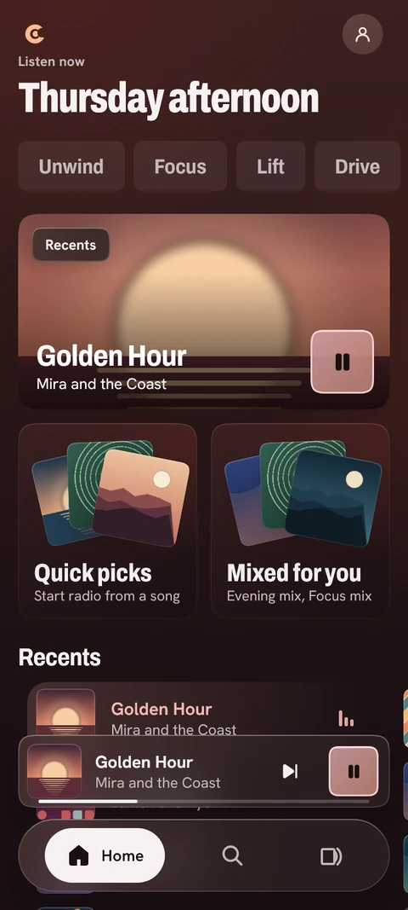<br><sub>Home picks up where you left off</sub></td>
    <td align="center" width="33%">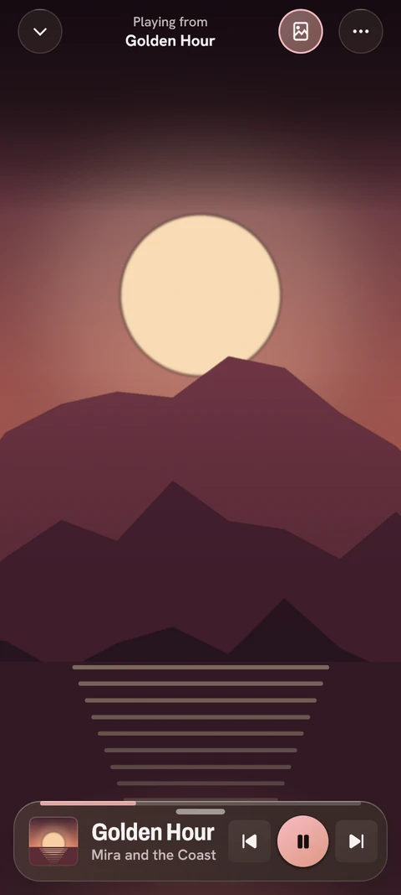<br><sub>The music video plays behind the song</sub></td>
    <td align="center" width="33%">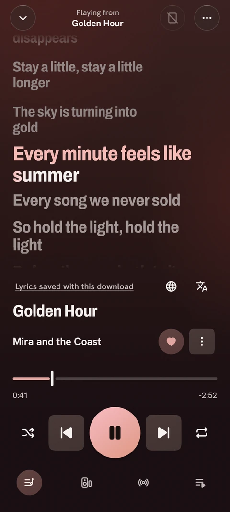<br><sub>Lyrics that follow the song</sub></td>
  </tr>
  <tr>
    <td align="center">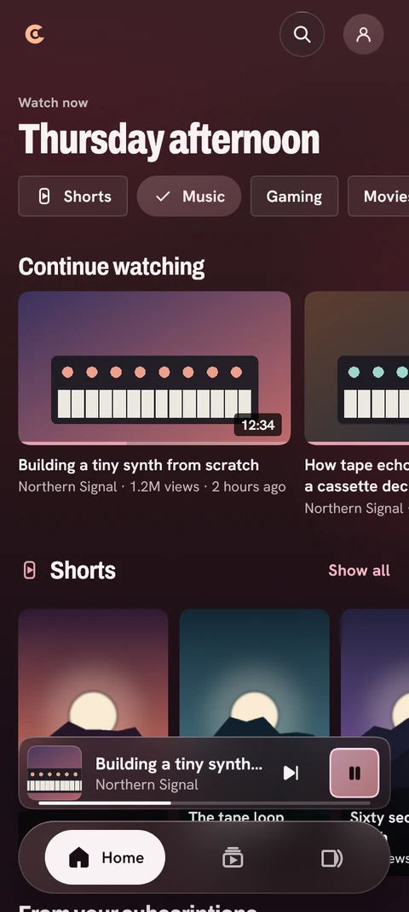<br><sub>Video mode, no account needed</sub></td>
    <td align="center">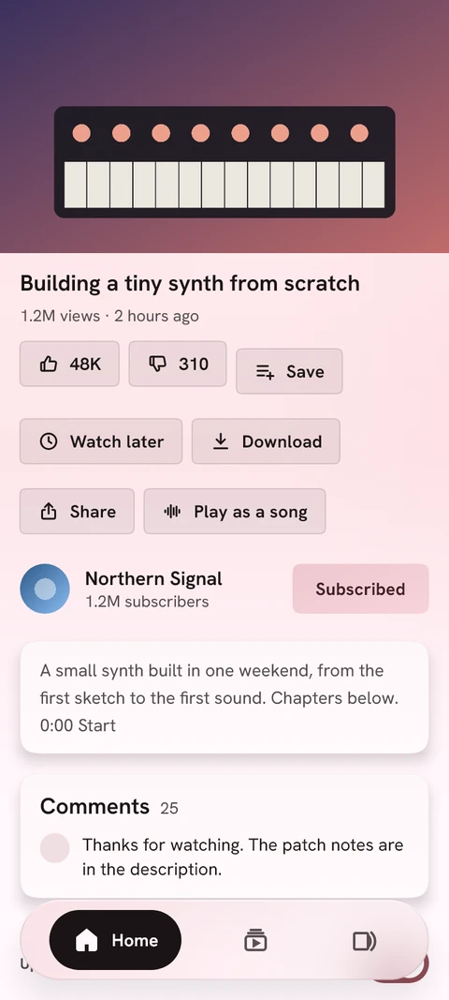<br><sub>A watch page, in the light theme</sub></td>
    <td align="center">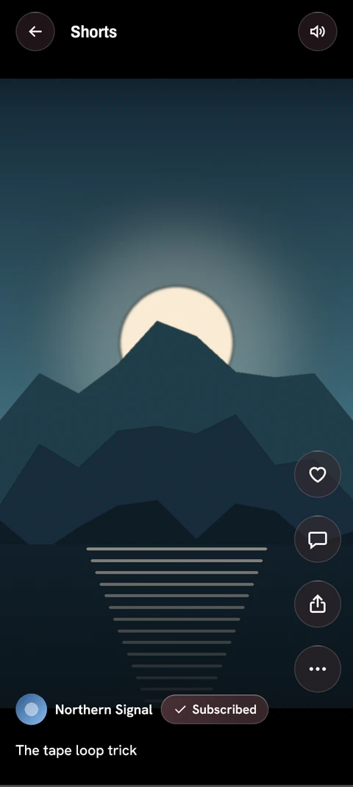<br><sub>Shorts, one after another</sub></td>
  </tr>
</table>

<table>
  <tr>
    <td align="center" width="50%">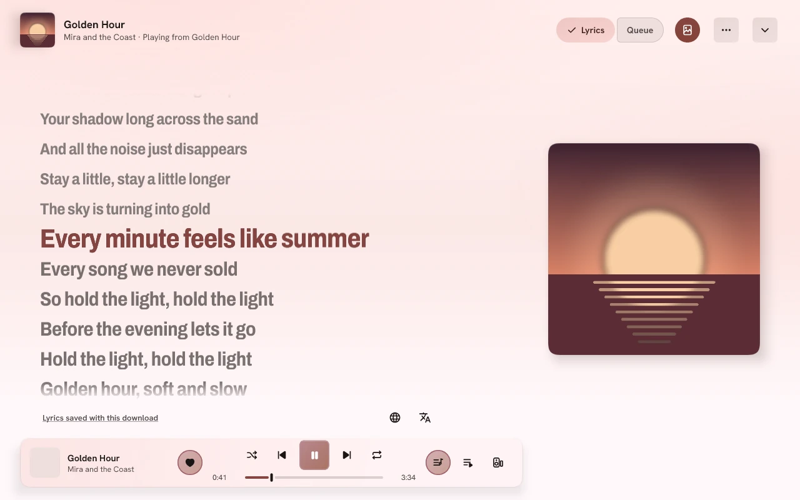<br><sub>Now Playing on the desktop</sub></td>
    <td align="center" width="50%">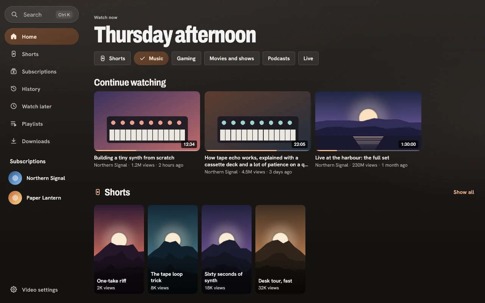<br><sub>Video mode on the desktop</sub></td>
  </tr>
</table>

## What it does

<table>
  <tr>
    <td width="36%" align="center">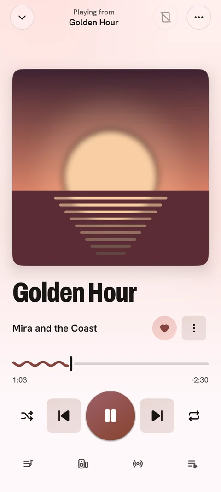</td>
    <td>
      <h3>Music</h3>
      <p>The colours of the whole app follow the cover of the song that is playing, in the light and the dark theme. Home starts
      with what you played last, then picks, mixes and new releases. Lyrics are synced line by line, and word by word where the
      source has the timing, and they can be translated or romanised. The queue can be reordered and saved as a named session to
      open again later. Replay shows your listening by month and year and can turn it into a playlist.</p>
      <p>Cosmotune also plays the music files on your device and keeps downloaded songs for listening offline.</p>
      <p>Version 1.0.3 adds a <a href="docs/LOCAL_RECOMMENDATIONS.md">3.19 MB local recommendation model</a> for AutoPlay and radio,
      trained with ListenBrainz, Music4All-Onion, Yambda and music metadata/acoustic context. It ranks on the device and keeps live
      provider radio/search for current songs. Raw listening histories and the full training catalogue are not bundled.
      <a href="docs/PACKAGE_SIZE.md">Desktop packages also drop foreign-platform ONNX and SQLite binaries</a>.</p>
    </td>
  </tr>
  <tr>
    <td>
      <h3>The music video, behind the song</h3>
      <p>With <a href="https://github.com/Vijay-Janarthanan/OpenCanvas">OpenCanvas</a>, Cosmotune finds the song's music video and
      lines it up with the song, so the picture follows the music. Version 1.0.2 adds film/album-aware discovery and publisher
      checks to reject matching fan dances, plus local face/person framing that follows actors and keeps groups in view.
      Physical Android framing validation is pending.
      <a href="https://vijay-janarthanan.github.io/OpenCanvas/#smart-framing">Try the framing-policy comparison</a>.
      You choose the video quality, or switch the video off. Over a
      video the controls fold down into a slim bar and the picture has the screen; a tap or a drag up brings them back. On Android
      the video is not looked up on mobile data unless you allow it. "Watch the music video" opens the video itself in Video mode.</p>
    </td>
    <td width="36%" align="center">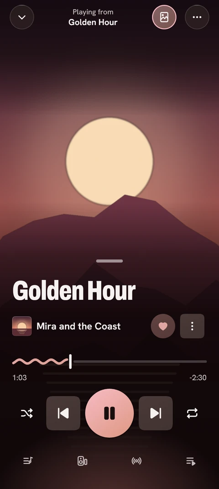</td>
  </tr>
  <tr>
    <td align="center">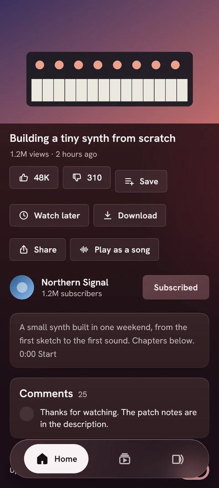</td>
    <td>
      <h3>Video mode</h3>
      <p>A full video app in the same install, with no account and no cookies: search, channels, subscriptions with a feed of their
      new uploads, Shorts, playlists, history and Watch later, comments and their replies, chapters, subtitles and live streams. You
      pick the speed and the quality, and on Android a video can keep playing in the background or in picture-in-picture.</p>
      <p><a href="https://sponsor.ajay.app/">SponsorBlock</a> skips the segments you choose, <a href="https://dearrow.ajay.app/">DeArrow</a>
      gives clearer titles and thumbnails, and <a href="https://returnyoutubedislike.com/">Return YouTube Dislike</a> brings back the
      dislike count. Each can be switched off. "Play as a song" hands a video to the music player.</p>
    </td>
  </tr>
  <tr>
    <td>
      <h3>Downloads and offline viewing</h3>
      <p>Keep a video at the quality you pick, or just its sound, with subtitles in the language you choose when you want them. A
      whole playlist, the newest uploads of a channel, Watch later or your feed can go down as one batch, which pauses and resumes
      together. Downloads can wait for Wi-Fi and pause when the battery is low, and everything you keep plays without a
      connection.</p>
    </td>
    <td align="center">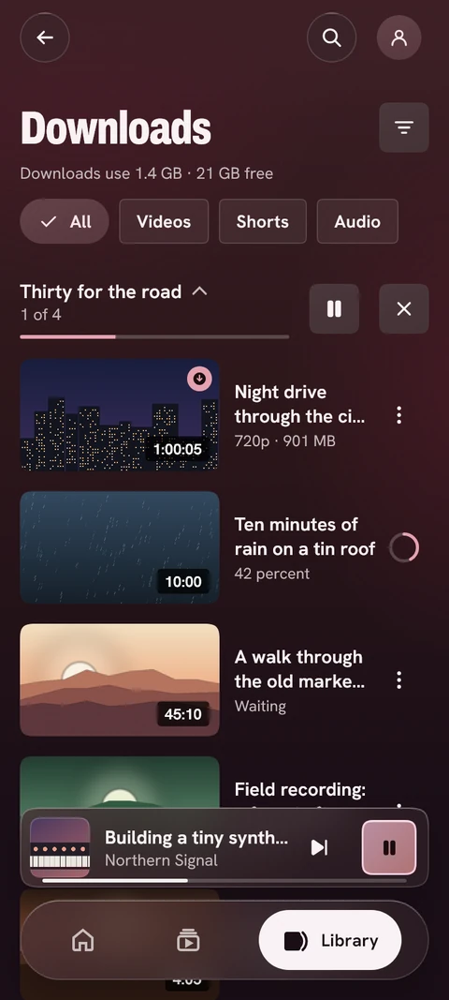</td>
  </tr>
  <tr>
    <td align="center">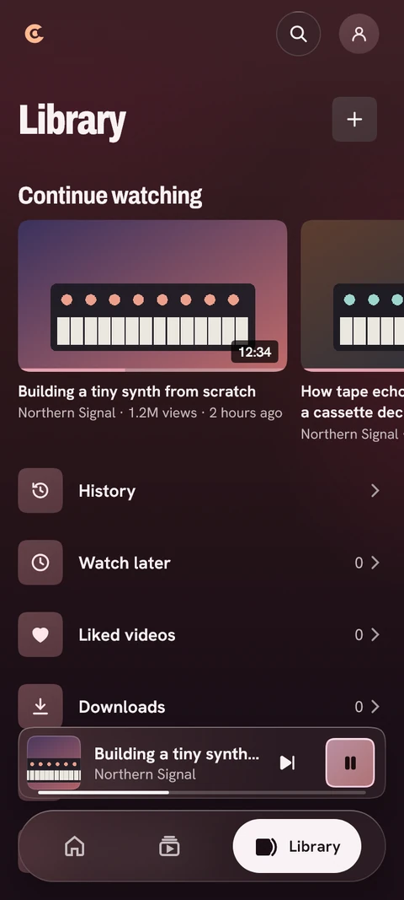</td>
    <td>
      <h3>Library and import</h3>
      <p>Your history, subscriptions, playlists and downloads are in the Library. Coming from another app? Video mode imports
      subscriptions, playlists and history from a <a href="https://github.com/TeamNewPipe/NewPipe">NewPipe</a> export or a Google
      Takeout archive, and subscriptions from an OPML file. In Music, your saved sessions and smart playlists can be exported to a
      file and imported on another device.</p>
    </td>
  </tr>
  <tr>
    <td>
      <h3>Listening together</h3>
      <p>Start a party and friends join from their own Cosmotune to hear the same song at the same moment; the host can keep the
      controls. Parties run through a party server whose address you enter in the app.</p>
      <h3>Private by default</h3>
      <p>There is no Cosmotune account and nothing to sign up for. Your history, preferences, subscriptions and playlists are kept on
      your device. Every service the app talks to is listed under <a href="#what-it-contacts">What it contacts</a>, and the optional
      ones can be switched off.</p>
    </td>
    <td align="center">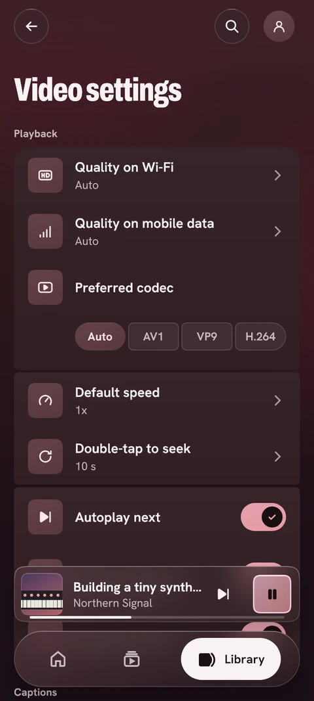</td>
  </tr>
</table>

Android and desktop are supported today. An iOS app is not available yet.

## Download

Version 1.0.4. The links below always fetch the newest release.
[1.0.4 release notes](docs/releases/1.0.4.md) · [All releases](https://github.com/Vijay-Janarthanan/cosmotune/releases) · [Report a bug](https://github.com/Vijay-Janarthanan/cosmotune/issues)

### Android

| File | For |
| :-- | :-- |
| [Cosmotune-android-arm64-v8a.apk](https://github.com/Vijay-Janarthanan/cosmotune/releases/latest/download/Cosmotune-android-arm64-v8a.apk) | Most phones and tablets |
| [Cosmotune-android-armeabi-v7a.apk](https://github.com/Vijay-Janarthanan/cosmotune/releases/latest/download/Cosmotune-android-armeabi-v7a.apk) | Older 32-bit phones |
| [Cosmotune-android-x86_64.apk](https://github.com/Vijay-Janarthanan/cosmotune/releases/latest/download/Cosmotune-android-x86_64.apk) | Emulators and x86 devices |
| [Cosmotune-android-universal.apk](https://github.com/Vijay-Janarthanan/cosmotune/releases/latest/download/Cosmotune-android-universal.apk) | Any device, when you are not sure (a larger file) |

<details>
<summary>Installing on Android</summary>

Needs Android 8.0 or newer. Open the downloaded file; Android asks once to allow installs from the app you downloaded it with
(your browser or file manager). Most phones need `arm64-v8a`; the universal file works on every phone.

</details>

### Windows

| File | For |
| :-- | :-- |
| [Cosmotune-windows-x64-setup.exe](https://github.com/Vijay-Janarthanan/cosmotune/releases/latest/download/Cosmotune-windows-x64-setup.exe) | The installer (64-bit Windows) |
| [Cosmotune-windows-x64.msi](https://github.com/Vijay-Janarthanan/cosmotune/releases/latest/download/Cosmotune-windows-x64.msi) | The same, as an MSI package |
| [Cosmotune-windows-x64-portable.zip](https://github.com/Vijay-Janarthanan/cosmotune/releases/latest/download/Cosmotune-windows-x64-portable.zip) | No installation: unzip and run |

<details>
<summary>Installing on Windows</summary>

Run the installer: it installs for your user account and adds a Start menu shortcut. The installer is not signed, so SmartScreen
may say "Windows protected your PC": choose **More info**, then **Run anyway**. For the portable zip, unzip it anywhere and run
`Cosmotune.exe`, keeping the folder together.

</details>

### Linux

| File | For |
| :-- | :-- |
| [Cosmotune-linux-x86_64.AppImage](https://github.com/Vijay-Janarthanan/cosmotune/releases/latest/download/Cosmotune-linux-x86_64.AppImage) | Any distribution, no installation |
| [Cosmotune-linux-amd64.deb](https://github.com/Vijay-Janarthanan/cosmotune/releases/latest/download/Cosmotune-linux-amd64.deb) | Debian, Ubuntu, Linux Mint and others |
| [Cosmotune-linux-x86_64.rpm](https://github.com/Vijay-Janarthanan/cosmotune/releases/latest/download/Cosmotune-linux-x86_64.rpm) | Fedora, openSUSE and others |

<details>
<summary>Installing on Linux</summary>

AppImage: make it executable and run it.

```sh
chmod +x Cosmotune-linux-x86_64.AppImage
./Cosmotune-linux-x86_64.AppImage
```

Debian or Ubuntu: `sudo apt install ./Cosmotune-linux-amd64.deb`. Fedora: `sudo dnf install ./Cosmotune-linux-x86_64.rpm`.

</details>

### macOS

| File | For |
| :-- | :-- |
| [Cosmotune-macos-arm64.dmg](https://github.com/Vijay-Janarthanan/cosmotune/releases/latest/download/Cosmotune-macos-arm64.dmg) | Apple Silicon (M1 and later) |
| [Cosmotune-macos-x64.dmg](https://github.com/Vijay-Janarthanan/cosmotune/releases/latest/download/Cosmotune-macos-x64.dmg) | Intel |

The same builds also come as an installer package ([Apple Silicon](https://github.com/Vijay-Janarthanan/cosmotune/releases/latest/download/Cosmotune-macos-arm64.pkg), [Intel](https://github.com/Vijay-Janarthanan/cosmotune/releases/latest/download/Cosmotune-macos-x64.pkg))
and as a zipped app ([Apple Silicon](https://github.com/Vijay-Janarthanan/cosmotune/releases/latest/download/Cosmotune-macos-arm64.zip), [Intel](https://github.com/Vijay-Janarthanan/cosmotune/releases/latest/download/Cosmotune-macos-x64.zip)).

<details>
<summary>Installing on macOS</summary>

Open the disk image and drag Cosmotune to Applications. Cosmotune is not signed by Apple. If macOS will not open it, right-click
the app and choose **Open**, or open **System Settings > Privacy & Security** and choose **Open Anyway**. If macOS says the app is
damaged, open Terminal and run `xattr -cr /Applications/Cosmotune.app`, then open it again.

Video mode's player has not been verified on macOS yet: the music side is complete there, but video playback may not start. Reports
from Mac users are welcome.

</details>

## Questions

<details>
<summary>Is it free?</summary>

Yes. Cosmotune is free and open source under the [GNU General Public License, version 3](LICENSE).

</details>

<details>
<summary>Do I need an account?</summary>

No. There is no Cosmotune account, and Music and Video mode both work without signing in anywhere.

</details>

<details>
<summary>Where does my data live?</summary>

On your device. Your listening history, preferences, subscriptions and playlists are kept in the app's own storage, and the music
videos in its own cache folder. Moving them to another device is an export and import of a file that you do yourself.

</details>

<details>
<summary>What does it connect to?</summary>

The full list, with what is sent to each service and how to switch the optional ones off, is under
[What it contacts](#what-it-contacts).

</details>

<details>
<summary>Will it get updates?</summary>

Yes. Each time it starts, Cosmotune asks GitHub for the latest release and tells you when a newer one is out. The Android app can
download it for you; the desktop app opens the download in your browser. The newest version is always on the
[releases page](https://github.com/Vijay-Janarthanan/cosmotune/releases).

</details>

<details>
<summary>Which platforms does it run on?</summary>

Android 8.0 or newer, 64-bit Windows, Linux on x86_64 (AppImage, deb or rpm), and macOS on Apple Silicon and Intel. An iOS app is
not available yet.

</details>

<details>
<summary>Is Video mode allowed by YouTube?</summary>

No. Video mode reads YouTube's public pages without an account, which YouTube's terms do not allow for third-party apps. Read the
[Disclaimer](#disclaimer) before you use it; the mode can be switched off by an update if asked.

</details>

## Feature development

[Feature tracker](FEATURE_TRACKER.md) records features from BitChord, Mornye, Lokal and Tsuki alongside Cosmotune's own work, with implementation, verification and release status kept separate.

The 1.0.4 work adds artist motion headers, optional artist signatures, a compact audio-format readout, queue fixes and a Wear OS companion. The watch can control the phone or act as its audio output; installation uses the matching companion APK bundled with the phone. See [Wear OS setup and limitations](wearos/README.md). These changes are still being validated before publication.

The same 1.0.4 scope includes [Mornye providers and local learning](docs/MORNYE_REVIEW.md), [Lokal providers and library features](docs/LOKAL_REVIEW.md), and [Manga mode](docs/MANGA_PLAN.md). Manga now has a local reader, shared source adapter, global enabled-source search, custom HTML templates, progress/downloads, optional Komga flow and Android extension/store integration in development. One publisher-verified real Android extension passed catalogue/chapter/page/image checks; the detailed plan distinguishes that from broader compatibility. Manga and the broader provider runtime are not yet published; the tracker records their remaining checks.

Development also includes [local library review and M3U8 export](docs/LOCAL_LIBRARY_TOOLS.md), byte-verified duplicate groups and previewed saved-session file repairs, plus a [paired desktop/TV phone remote](docs/LAN_REMOTE.md) with QR setup, playback/seek/volume and scoped music search. A signed minified Android checkpoint passed real Music/Manga/Video mode switching and a public Manga Plus chapter with restored progress. The separate [TV app](tv/README.md) has signed packages and a D-pad setup/Home/settings walkthrough; remote/effect follow-up checks are in progress. The [browser player and helper extensions](web/README.md) build separately, with parser/player/bridge tests and package licence checks. No browser site is deployed automatically. These are implementation checkpoints for the coordinated 1.0.4 update, not a published release.

[Provider packages](docs/PROVIDER_PACKAGES.md) now have shared repository/import management, reviewed installation, settings, search, catalogue/home browsing and direct audio streaming in development. A live public JioSaavn source passed metadata and AAC decoding checks. Checked source covers and provider-fed Home sections now use the native loaders and queues. [Local source libraries](docs/SOURCE_LIBRARY.md) add source ratings, saved collections and follows without a YouTube account. Provider-owned PKCE sign-in, protected cookies and bounded cipher helpers now have fixture coverage. Segmented audio downloads share bounded/cancellable transport on phone and desktop. The runtime's remaining signed-session, automatic callback, transform and output-device work is documented; importing a package alone does not establish full compatibility. [Local preference learning](docs/LOCAL_PREFERENCE_LEARNING.md) adds 65,568 bytes of private state while keeping the base model and personal files below 5 MB.

## Feedback and contributing

Found a layout or playback problem? [Open an issue](https://github.com/Vijay-Janarthanan/cosmotune/issues)
with your app version, operating system, steps to reproduce and a screenshot when helpful.
For display issues, include your screen size and display/text scaling. Remove private information from logs.

Contributions are welcome. Read [the maintenance guide](docs/MAINTAINING.md) before changing code;
[FORK.md](FORK.md) records the changes we keep when merging upstream.

## Build

Needs JDK 21. `./gradlew :desktopApp:run` starts the desktop app;
`./gradlew :app:assembleDevDebug` builds the Android app. Notes for working on the code are in
[the maintenance guide](docs/MAINTAINING.md).

## What it contacts

The music video needs an internet connection. With it on (the default), Cosmotune searches YouTube for each song's
video by title and artist, then reads the start of the song's file and of up to six candidate videos' files from
YouTube's servers to line them up: about 320 KB per file, and more for a file with a large header or another layout,
up to the whole file. It also asks `cdn.jsdelivr.net` (which serves the `Vijay-Janarthanan/OpenCanvas` repository on
GitHub) for a ready-made sync map, sending only the song's YouTube id, and still talks to the music and cover sources
it used before. The video lookup sends no account or sign-in data. The maps it measures are kept in the app's own
folder and the video itself in the app's own cache folder (up to 150 MB on Android; on the desktop the media cache,
512 MB by default). On Android the video is not looked up on mobile data (any metered connection) unless you turn on
Settings > Appearance > "Play animated cover over cellular", which is off by default. Switch the video off under
Settings > Appearance > "Dynamic YouTube Canvas (OpenCanvas)", which appears only while "Animated cover art" (Android)
or "Animated canvas" (desktop) is on. Even with the video switched off, the app makes three small requests to YouTube
each time it starts (two to open the connection and one for an anonymous visitor id), also on mobile data.
The current source also analyses decoded video frames locally with YuNet and YOLOX-Nano for actor framing;
these frames are not uploaded. Its cache stores framing coordinates, not captured images.

**Video mode** looks videos up on YouTube with no account and no cookies: search, video pages, comments, channel and
RSS feeds, thumbnails and the video files. When it is on, SponsorBlock gets the first four characters of a hash of each
video id you open (`sponsor.ajay.app`); DeArrow gets the same for titles and the video id for thumbnails
(`sponsor.ajay.app`, `dearrow-thumb.ajay.app`); Return YouTube Dislike gets the video id of each video page you open
(`returnyoutubedislikeapi.com`). Each can be switched off in Video settings. Your history, subscriptions and
playlists are kept on the device.

## Disclaimer

Cosmotune uses YouTube's own player endpoints, which YouTube does not document and its terms do not
allow for third-party apps. Use it at your own risk.

**Video mode.** Cosmotune is not affiliated with, authorised or endorsed by YouTube or Google. Video mode reads
YouTube's public pages without an account, which YouTube's terms do not allow for third-party apps. Use it at your own
risk. The mode can be switched off by an update if asked.

## Acknowledgements

Cosmotune started as a fork of [BitChord](https://github.com/kushagrasinghx/BitChord) (GPLv3) and still
shares much of its playback engine. Its ideas and look draw on open-source players such as
[NewPipe](https://github.com/TeamNewPipe/NewPipe), [LibreTube](https://github.com/libre-tube/LibreTube),
[SimpMusic](https://github.com/maxrave-dev/SimpMusic) and [Namida](https://github.com/namidaco/namida).
The music-video canvas is [OpenCanvas](https://github.com/Vijay-Janarthanan/OpenCanvas).

Video mode reads its catalogue with [NewPipeExtractor](https://github.com/TeamNewPipe/NewPipeExtractor)
(GPL-3.0-or-later), plays video on the desktop with [libmpv](https://mpv.io/) (taken from the runtime packages of
[mediamp](https://github.com/open-ani/mediamp)), and uses the data of [SponsorBlock](https://sponsor.ajay.app/) (skippable
segments), [DeArrow](https://dearrow.ajay.app/) (titles and thumbnails) and
[Return YouTube Dislike](https://returnyoutubedislike.com/) (dislike counts). Licences and notices are in [NOTICE.md](NOTICE.md).
