<div align="center">

<picture>
  <source media="(prefers-color-scheme: dark)" srcset="docs/images/wordmark-dark.svg">
  <source media="(prefers-color-scheme: light)" srcset="docs/images/wordmark-light.svg">
  
</picture>

<h3>Music that plays with its video, remembers what you like and picks what comes next.</h3>

Version 1.0.19 adds a compact Audio Pipeline entry beneath the artwork on portrait phones, expands the free Live TV and book catalogues, and improves AutoMix recovery, artwork caching and synced lyrics. [1.0.19 release notes](docs/releases/1.0.19.md)

Version 1.0.17 gives the whole app a new look, called Orbit, on the phone, the desktop, the TV and the watch. It adds Watch, a mode for free films, series and live TV with plugins; Live now, for the scores of the matches you follow and live shows; and Indian channels from Prasar Bharati (DD) and the broadcasters' own live news. The sleep timer now pauses on time with the screen off. [1.0.17 changes and limits](docs/releases/1.0.17.md) · [Remaining work](docs/PENDING_WORK.md)

Version 1.0.16 adds shared rooms (listen, watch and talk together, each person in their own app: songs, videos, live radio and podcasts, with chat and voice) and an optional Cosmotune account that keeps your playlists, likes and followed artists the same on your devices, and keeps lyrics and music videos moving when the desktop window loses focus. [1.0.16 changes and validation limits](docs/releases/1.0.16.md)

[Downloads](https://github.com/Vijay-Janarthanan/cosmotune/releases/latest) point to the latest published installers. New source changes require an updated app build; release assets are published after the platform build workflow succeeds. [Playback findings and upstream integration evidence](docs/UPSTREAM_IMPLEMENTATION_2026-10-28.md).

**Included in 1.0.14 and kept in 1.0.15:** device EQ profiles and truthful output guidance, broader local discovery and editable mixes, shared song-list controls, recoverable Video Home feeds, improved Manga browsing and source filtering, plus Read with EPUB/PDF books, colour illustrations, bookmarks and catalogue discovery. [Audio and discovery scope](docs/HEADPHONES_AND_DISCOVERY_PLAN_2026-11-02.md) · [Video repair evidence](docs/VIDEO_PLAYBACK_REPAIRS_2026-11-02.md) · [Read implementation and source matrix](docs/READING_BOOKS_PLAN_2026-11-02.md) · [1.0.14 notes](docs/releases/1.0.14.md).

Version 1.0.9 rebuilds Podio around a satellite radio globe with city-level zoom, nearby-station selection, on-air metadata and station pages with local time, weather, credited photos and articles. Podcasts gain regional charts and genre filters. [1.0.9 changes](docs/releases/1.0.9.md)

Version 1.0.8 aligns Manga and Podio with the native theme, keeps artist photographs visible when replacement artwork fails, repairs case-sensitive radio language searches, expands the radio map, and makes regional/language discovery prominent with shorter menus.

Version 1.0.7 adds provider audio preparation and comparisons, tappable audio details, regional discovery and local playlist previews, automatic verification callbacks, and fixes for Windows playback freezing and Now Playing window dragging. Amazon passed actual Windows decoding as 24-bit/44.1 kHz FLAC; Qobuz package availability remains limited by its gateway. [Playback evidence](docs/PROVIDER_MEDIA_PREPARATION.md).

**Podio** brings live radio and podcasts to Android phone/tablet and desktop: explore stations on a globe, search by country/language, save favourites, discover shows and open publisher RSS feeds without an account. Spotify podcast links can find matching public RSS audio; Spotify-only and paid-only audio are unsupported. Following and episode progress stay on your device. [Reviewed projects, playback evidence and limits](docs/PODIO_RESEARCH.md).

<p>For Android, Windows, Linux and macOS, with a Wear OS watch app, an Android TV app and a browser companion. Free and open source.</p>

<p>
  <a href="https://github.com/Vijay-Janarthanan/cosmotune/releases/latest"></a>
  <a href="https://github.com/Vijay-Janarthanan/cosmotune/releases"></a>
  <a href="LICENSE"></a>
  
  
</p>

<p>
  <a href="#android"></a>
  <a href="#windows"></a>
  <a href="#linux"></a>
  <a href="#macos"></a>
</p>

<picture>
  <source media="(prefers-color-scheme: dark)" srcset="docs/images/phone-music-home-dark.webp">
  <source media="(prefers-color-scheme: light)" srcset="docs/images/phone-music-home-light.webp">
  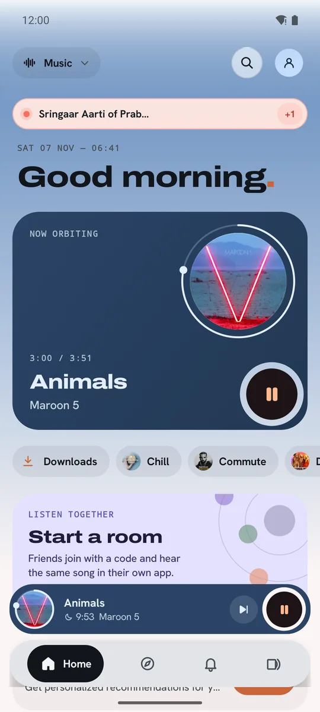
</picture>

<sub>The pictures on this page are screenshots of Cosmotune 1.0.17 on a phone, a desktop, a TV and a watch. The songs, videos, channels and logos in them belong to their owners.</sub>

</div>

Source-comparison details, country/language discovery controls and locally ranked playlist previews have shipped since 1.0.7. See the [provider inventory and validation](docs/PROVIDER_CAPABILITIES.md) and [Amazon resolution findings](docs/AMAZON_RESOLUTION_INVESTIGATION.md).

[Dedicated provider verification windows](docs/PROVIDER_VERIFICATION_BROWSER.md) handle a service's grant automatically after its check, with manual recovery when needed. Windows Qobuz verification has live proof; audio preparation and other platform/device checks remain separately documented.

Visit the [Cosmotune website](https://cosmotune.shutterisland.in/), [OpenCanvas website](https://opencanvas.shutterisland.in/) and [Shutter Island project portfolio](https://www.shutterisland.in/). [Hosting and website maintenance](docs/LIVE_WEBSITES.md).

## Screenshots

### Phone

<table>
  <tr>
    <td align="center" width="25%">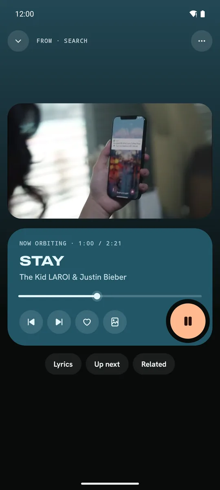<br><sub>The music video, shown whole</sub></td>
    <td align="center" width="25%">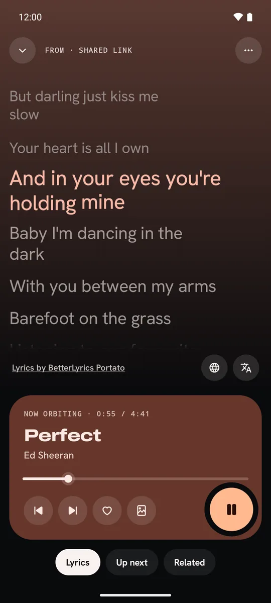<br><sub>Lyrics that follow the song</sub></td>
    <td align="center" width="25%">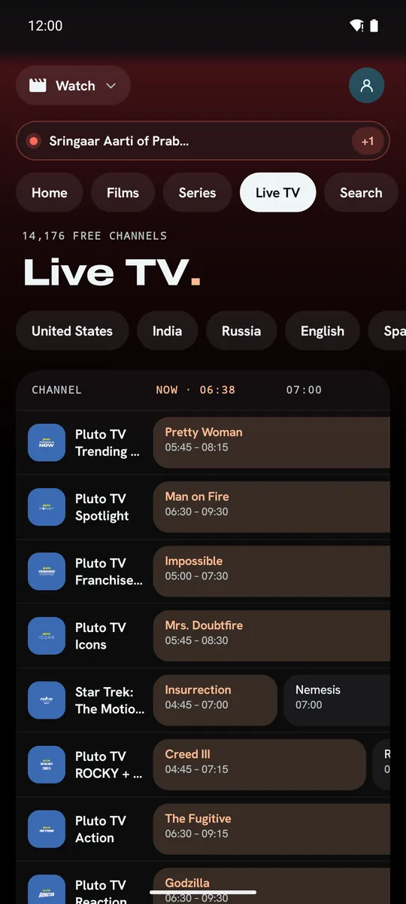<br><sub>Watch: live TV with a guide</sub></td>
    <td align="center" width="25%">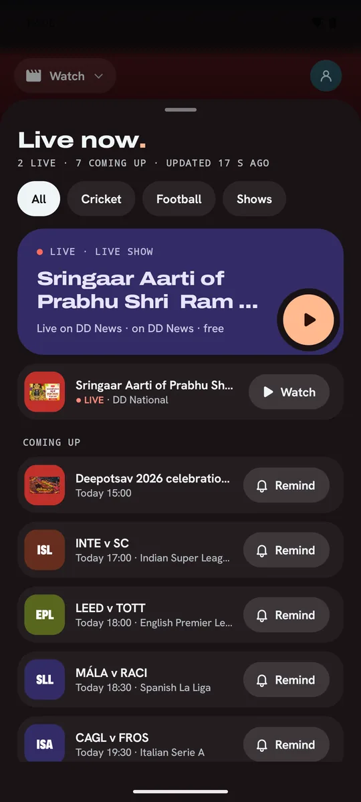<br><sub>Live now: what's on and what's next</sub></td>
  </tr>
  <tr>
    <td align="center">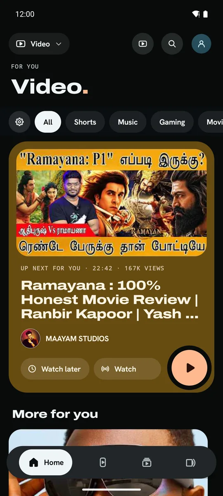<br><sub>Video mode, no account needed</sub></td>
    <td align="center">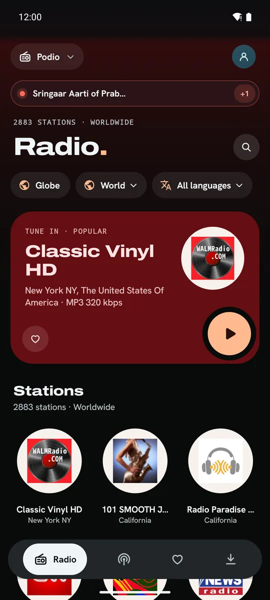<br><sub>Podio: radio from anywhere</sub></td>
    <td align="center">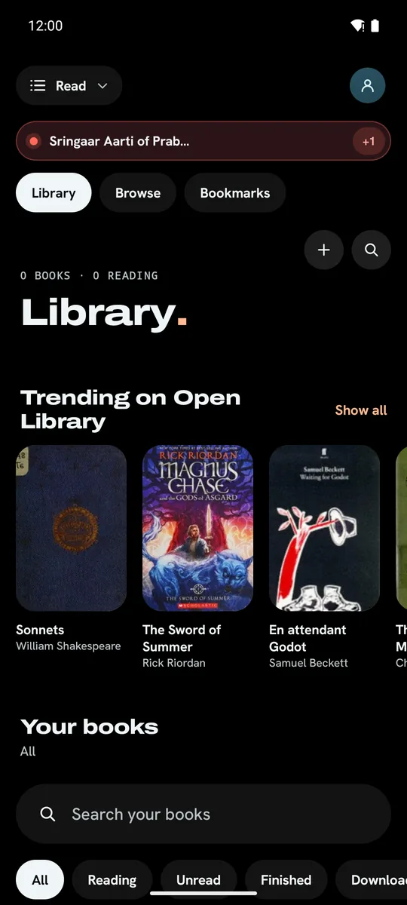<br><sub>Read: books and manga</sub></td>
    <td align="center">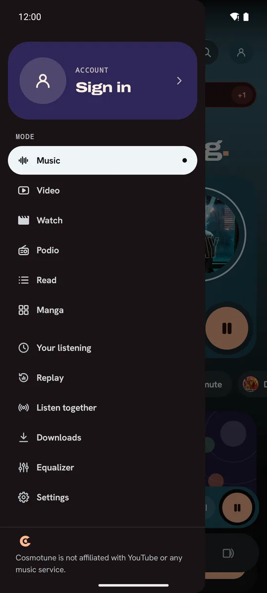<br><sub>Every mode from one drawer</sub></td>
  </tr>
</table>

### Desktop

<table>
  <tr>
    <td align="center" width="50%">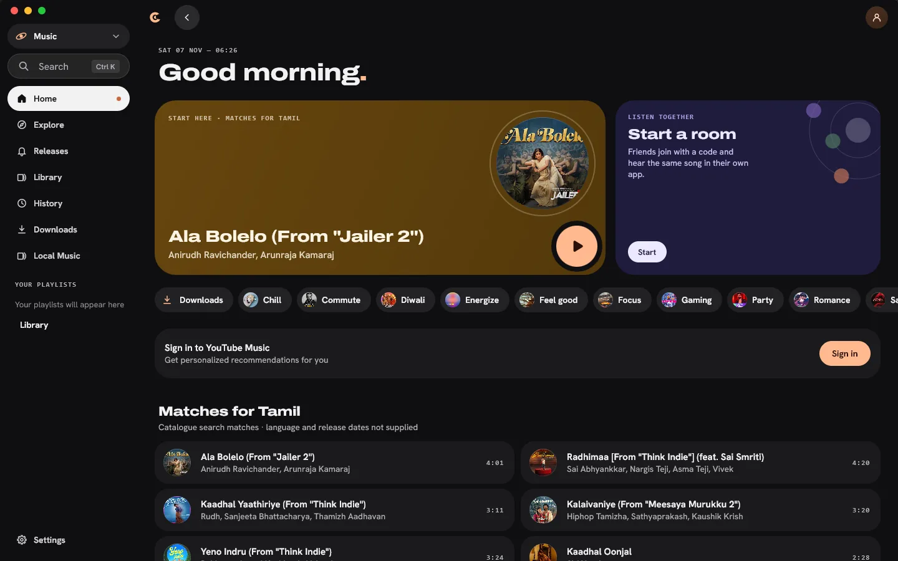<br><sub>Music on the desktop</sub></td>
    <td align="center" width="50%">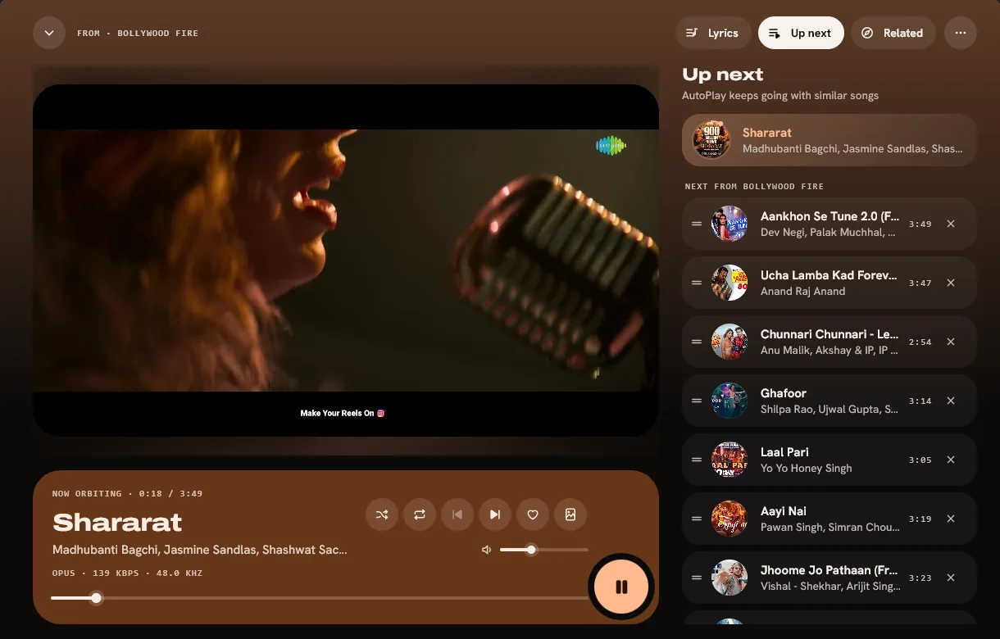<br><sub>Now Playing with the video and Up next</sub></td>
  </tr>
  <tr>
    <td align="center">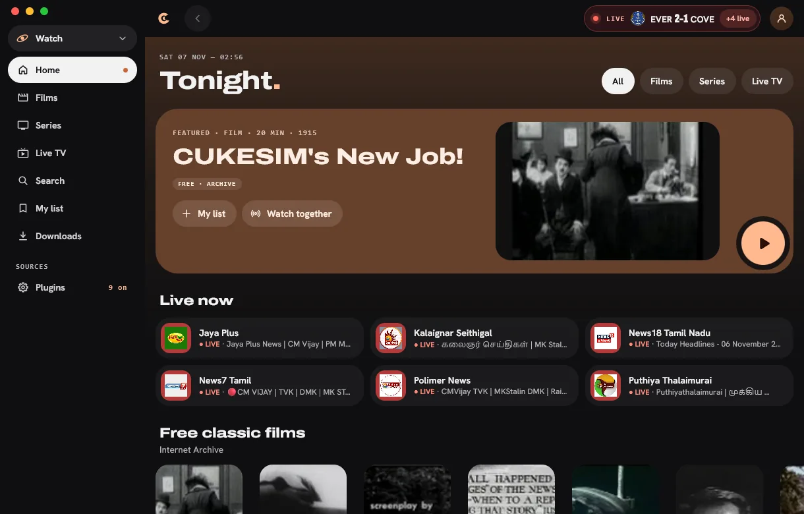<br><sub>Watch on the desktop</sub></td>
    <td align="center">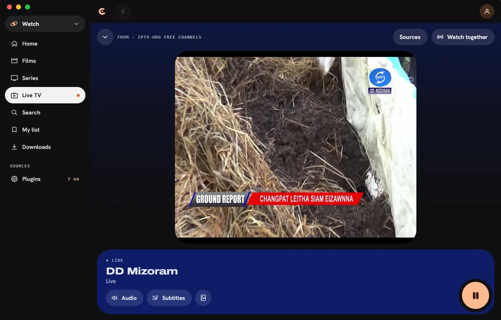<br><sub>A DD channel, live</sub></td>
  </tr>
</table>

### TV

<table>
  <tr>
    <td align="center" width="50%">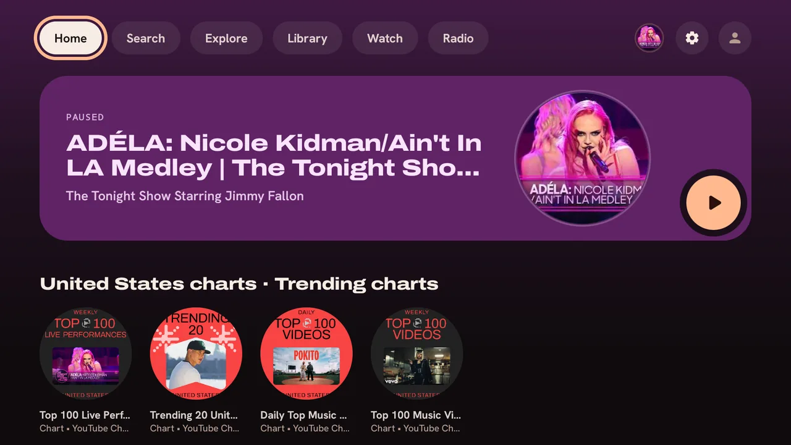<br><sub>Home on the TV</sub></td>
    <td align="center" width="50%">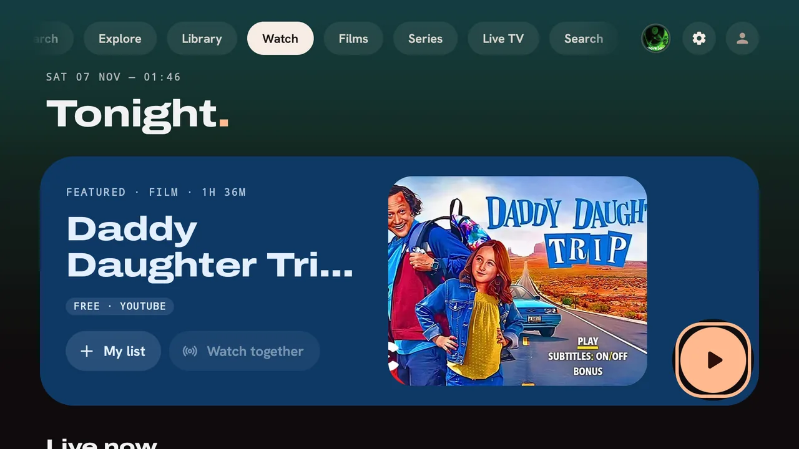<br><sub>Watch on the TV</sub></td>
  </tr>
  <tr>
    <td align="center">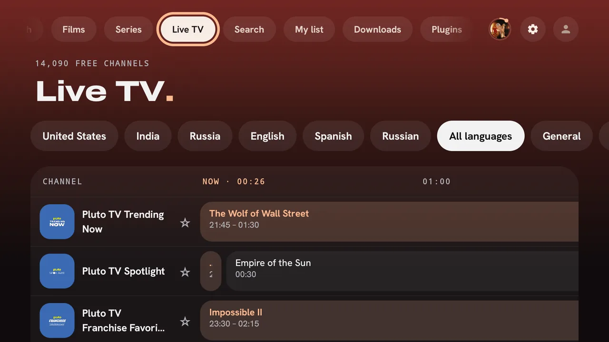<br><sub>Live TV with a guide</sub></td>
    <td align="center">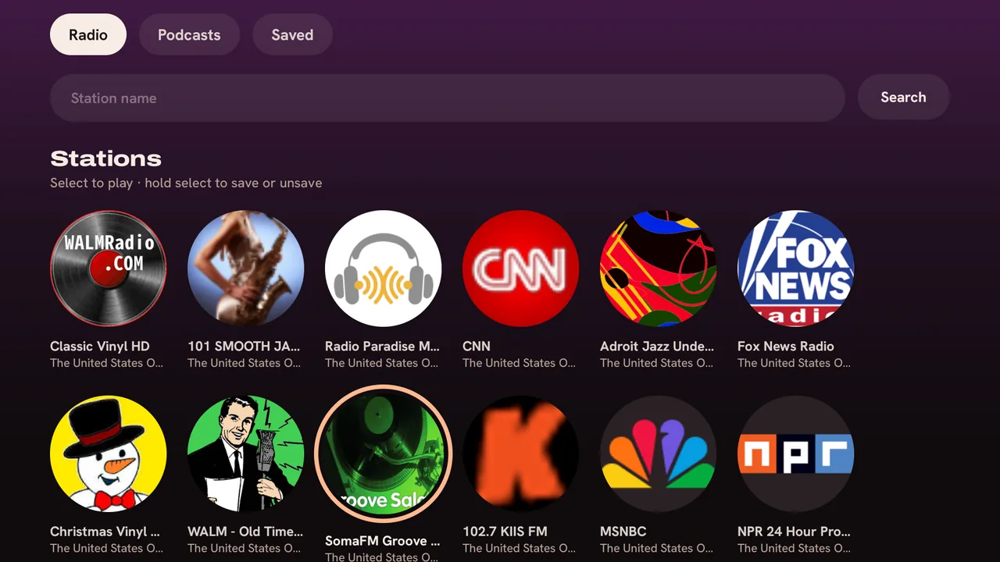<br><sub>Podio radio on the TV</sub></td>
  </tr>
</table>

### Wear OS

<table>
  <tr>
    <td align="center" width="50%">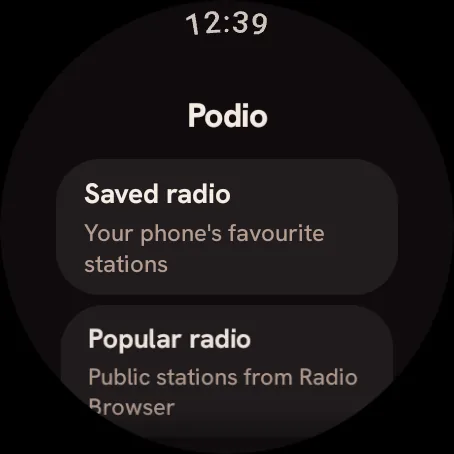<br><sub>Podio on the watch</sub></td>
    <td align="center" width="50%">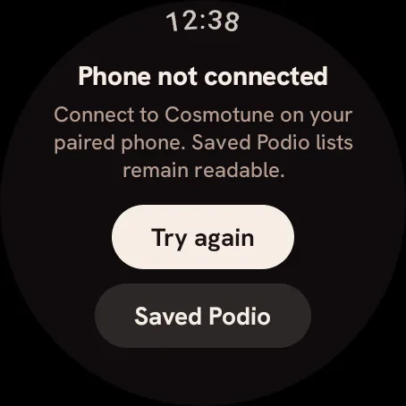<br><sub>Saved Podio lists stay readable without the phone</sub></td>
  </tr>
</table>

## What it does

<table>
  <tr>
    <td width="36%" align="center">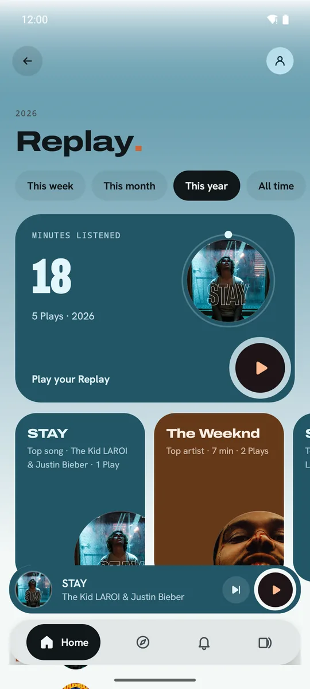</td>
    <td>
      <h3>Music</h3>
      <p>Orbit, the new look in 1.0.17, draws covers as round discs, with the song's progress as an orbit round the disc. Each page
      leads with one colour card in its own cover's colour, and nothing is drawn on top of a cover or a video.</p>
      <p>The colours of the whole app follow the cover of the song that is playing, in the light and the dark theme. Home starts
      with what you played last, then picks, mixes and new releases. Lyrics are synced line by line, and word by word where the
      source has the timing, and they can be translated or romanised. The queue can be reordered and saved as a named session to
      open again later. Replay shows your listening by month and year and can turn it into a playlist.</p>
      <p>Cosmotune also plays the music files on your device and keeps downloaded songs for listening offline.</p>
      <p>AutoPlay and radio are ranked on the device by a <a href="docs/LOCAL_RECOMMENDATIONS.md">3.19 MB local recommendation model</a>,
      trained with ListenBrainz, Music4All-Onion, Yambda and music metadata/acoustic context, plus a small private learner that
      follows your plays and skips. Live provider radio and search still supply current songs. Raw listening histories and the full
      training catalogue are not bundled.</p>
      <p>Version 1.0.4 adds library tools (loudness analysis, duplicate review, tag editing, M3U8 export, linked playlists, quality
      review), search across your add-ons and provider packages, Subsonic servers, Manga mode, a phone remote for the desktop and the
      TV, and companions for Wear OS, Android TV and the browser. See the <a href="docs/releases/1.0.4.md">release notes</a>.</p>
    </td>
  </tr>
  <tr>
    <td>
      <h3>The music video, with the song</h3>
      <p>With <a href="https://github.com/Vijay-Janarthanan/OpenCanvas">OpenCanvas</a>, Cosmotune finds the song's music video and
      lines it up with the song, so the picture follows the music. Version 1.0.2 adds film/album-aware discovery and publisher
      checks to reject matching fan dances. Since 1.0.17 the video is shown whole by default, never cropped to a tall frame, and
      the space round it gets a soft glow from its own colours. A screen button in the song card offers Whole, Fill, Cinema and
      Off. Cinema gives the window to the video, with the card floating at the foot; press F or double-click to enter it and Esc
      to leave, or turn the phone sideways. The app keeps subject tracking disabled; the separate library's face/person policy
      remains available for integration and validation.
      <a href="https://vijay-janarthanan.github.io/OpenCanvas/#smart-framing">Try the framing-policy comparison</a>.
      You choose the video quality, or switch the video off. On Android the video is not looked up on mobile data unless you
      allow it. "Watch the music video" opens the video itself in Video mode.</p>
      <h3>Sleep timer</h3>
      <p>The sleep timer shows as a pill with the time left in Now Playing, beside pills for the other features in use. It pauses on
      time with the screen off, and pauses casting, rooms, Video and Watch too.</p>
    </td>
    <td width="36%" align="center">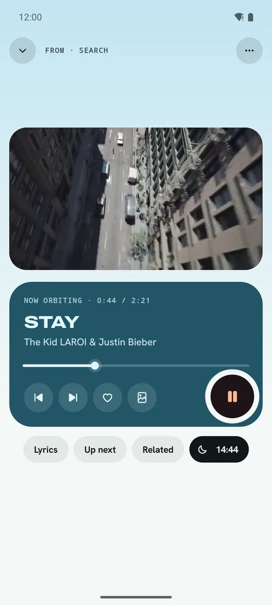</td>
  </tr>
  <tr>
    <td align="center">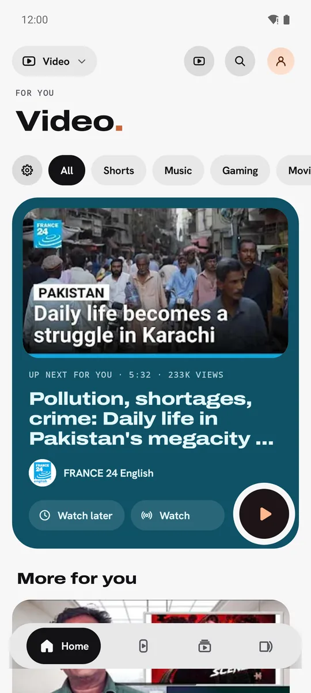</td>
    <td>
      <h3>Video mode</h3>
      <p>A full video app in the same install, with no account and no cookies: search, channels, subscriptions with a feed of their
      new uploads, Shorts, playlists, history and Watch later, comments and their replies, chapters, subtitles and live streams. You
      pick the speed and the quality, and on Android a video can keep playing in the background or in picture-in-picture.</p>
      <p><a href="https://sponsor.ajay.app/">SponsorBlock</a> skips the segments you choose, <a href="https://dearrow.ajay.app/">DeArrow</a>
      gives clearer titles and thumbnails, and <a href="https://returnyoutubedislike.com/">Return YouTube Dislike</a> brings back the
      dislike count. Each can be switched off. "Play as a song" hands a video to the music player.</p>
      <h3>Downloads and offline viewing</h3>
      <p>Keep a video at the quality you pick, or just its sound, with subtitles in the language you choose when you want them. A
      whole playlist, the newest uploads of a channel, Watch later or your feed can go down as one batch, which pauses and resumes
      together. Downloads can wait for Wi-Fi and pause when the battery is low, and everything you keep plays without a
      connection.</p>
    </td>
  </tr>
  <tr>
    <td>
      <h3>Watch: films, series and live TV</h3>
      <p>A mode for films, series and live TV (Ctrl+3 on the desktop), with Home, Films, Series, Live TV with a programme guide,
      Search, My list, Downloads and Plugins. It plays out of the box from built-in plugins, each with its own switch: free live
      channels (iptv-org, Free-TV/IPTV, Pluto TV, Samsung TV Plus, Plex), free films and series (Plex, the Internet Archive, official free YouTube
      channels), and Stremio's Public Domain Movies, OpenSubtitles and WatchHub add-ons. No torrent, debrid or pirate-site plugins
      are built in.</p>
      <p>Add more sources yourself: Stremio and Nuvio add-on links, your own Jellyfin, Emby or Plex server, M3U and Xtream playlists
      with guides, and local folders. <b>Find plugins</b> links to plugin directories, so you can add what you have access to.
      Plugin packs can be shared by link or QR code and offered in a room, and with cloud sync your plugins follow you to your other
      devices. Films, episodes and channels can be watched together in a room; each person's app finds the same title in its own
      sources.</p>
      <p>Film and series details come from TMDB. This product uses the TMDB API but is not endorsed or certified by TMDB.</p>
    </td>
    <td align="center">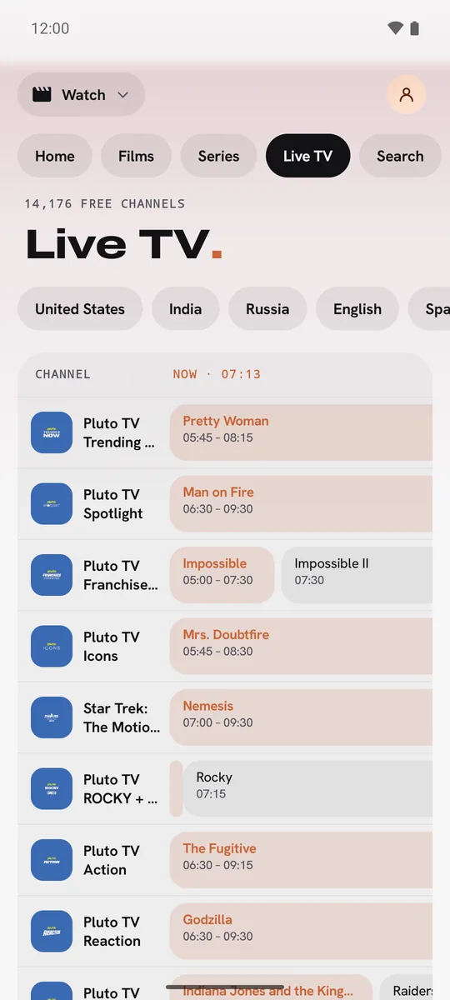</td>
  </tr>
  <tr>
    <td align="center">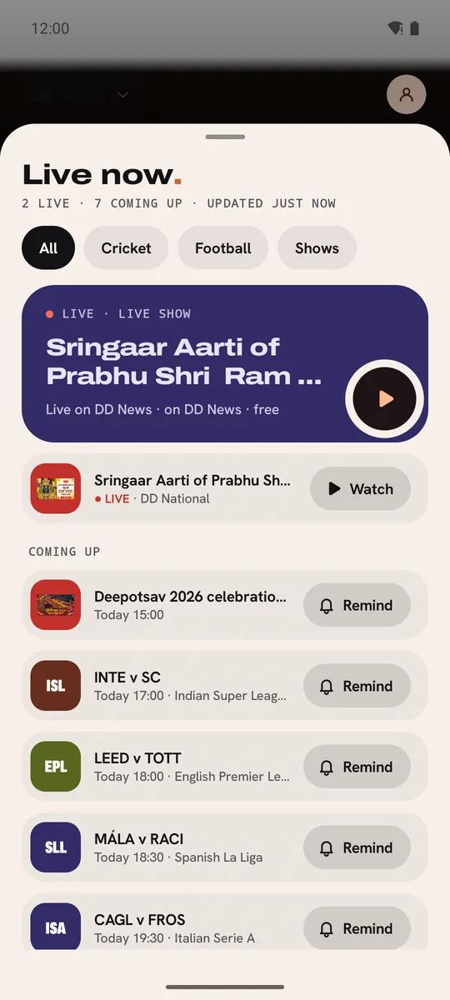</td>
    <td>
      <h3>Live now</h3>
      <p>A Live pill shows the score of the match or show you follow and how many more are live. It opens Live now: live matches and
      shows, what's coming up with a reminder, and what just finished. Watch is offered only where a free stream carries the event:
      DD Sports, DD National or a broadcaster's own YouTube live stream. Cricket scores come from CricketData.org and football scores
      from football-data.org, each with a free key; without one, TheSportsDB gives the next and last match only. Settings > Live now
      turns the pill on or off, picks your sports and follows teams.</p>
      <h3>Indian channels</h3>
      <p>Prasar Bharati (DD): DD News, DD India, DD National, DD Sports, DD Kisan, DD Urdu, DD Bharati, DD Tamil and the regional DD
      channels, played from Prasar Bharati's own YouTube channels. Live on YouTube: the broadcasters' own live news streams in
      Tamil, Telugu, Malayalam, Kannada, Hindi and English, and Sansad TV. DD channels other than DD News, DD India, DD Kisan and
      DD Urdu are live only during programmes. Pay channels such as Sun TV, Vijay TV and Zee Tamil are not built in; Find plugins in
      Watch links to plugin directories instead.</p>
    </td>
  </tr>
  <tr>
    <td colspan="2">
      <h3>Library and import</h3>
      <p>Your history, subscriptions, playlists and downloads are in the Library. Coming from another app? Video mode imports
      subscriptions, playlists and history from a <a href="https://github.com/TeamNewPipe/NewPipe">NewPipe</a> export or a Google
      Takeout archive, and subscriptions from an OPML file. In Music, your saved sessions and smart playlists can be exported to a
      file and imported on another device.</p>
      <h3>Shared rooms</h3>
      <p>Make a room and friends join with a six-character code from their own Cosmotune (phone or desktop). Whatever the host plays,
      a song, a video from Video mode, a live radio station or a podcast episode, plays on everyone's own device in their own app, so
      nothing is streamed between you and everyone keeps their own quality, captions and speed. There is a chat with song requests, a
      room icon in every mode, and a first version of voice: everyone joins muted and can unmute any time, and you can mute or turn
      down anyone for yourself only. Rooms need an internet connection; the host can keep the controls. Voice connects devices
      directly, so some mobile networks may not connect yet.</p>
      <h3>Private by default</h3>
      <p>You do not need a Cosmotune account and there is nothing to sign up for. Your history, preferences, subscriptions and playlists
      are kept on your device. An optional cloud account, off until you turn it on, can keep your playlists the same on your devices
      (see <a href="#cloud-sync-optional">Cloud sync</a>). The services the app talks to are described under <a href="#what-it-contacts">What it contacts</a>, and the
      optional ones can be switched off.</p>
    </td>
  </tr>
</table>

Android phones and tablets, Wear OS watches, Android TV, Windows, Linux and macOS are supported, and the music player also runs in a browser. An iOS app is not available yet.

## Cloud sync (optional)

Cosmotune works with no account. If you want your playlists to follow you from phone to computer, Settings > Account & sync has a
**Turn on cloud sync** switch (new in 1.0.16). Until you turn it on, nothing is sent anywhere.

- **What you get:** a guest account made on your device, or **Sign in with Google** (Android and desktop) so the same library
  appears wherever you sign in. Changes merge by the newest edit, and a deleted playlist stays deleted on every device.
- **What is synced:** playlist names and their songs (identifiers, titles, artists, artwork links). Not audio, not files on your
  device, not your YouTube sign-in. Likes and followed artists sync as well.
- **Where it lives:** Google Firebase (Authentication; Cloud Firestore in Mumbai; Realtime Database in Singapore for the shared
  rooms that are being built). Security rules let each person read and write only their own data.
- **Your control:** Sign out stops syncing on that device; **Delete cloud account and data** removes everything stored for the
  account. [Privacy policy](https://cosmotune-vj-c4394.web.app/privacy.html).
- **For builders:** the security rules, their tests and the setup are in [firebase/](firebase/README.md). Desktop Google sign-in
  needs a Desktop OAuth client: put `GOOGLE_DESKTOP_CLIENT_ID` and `GOOGLE_DESKTOP_CLIENT_SECRET` in `local.properties` (release
  builds read the same names from repository variables or secrets). A build without them offers the guest account only.

## Download

Version 1.0.19. The links below always fetch the newest release.
[1.0.19 release notes](docs/releases/1.0.19.md) · [All releases](https://github.com/Vijay-Janarthanan/cosmotune/releases) · [Report a bug](https://github.com/Vijay-Janarthanan/cosmotune/issues)

### Android

| File | For |
| :-- | :-- |
| [Cosmotune-android-arm64-v8a.apk](https://github.com/Vijay-Janarthanan/cosmotune/releases/latest/download/Cosmotune-android-arm64-v8a.apk) | Most phones and tablets |
| [Cosmotune-android-armeabi-v7a.apk](https://github.com/Vijay-Janarthanan/cosmotune/releases/latest/download/Cosmotune-android-armeabi-v7a.apk) | Older 32-bit phones |
| [Cosmotune-android-x86_64.apk](https://github.com/Vijay-Janarthanan/cosmotune/releases/latest/download/Cosmotune-android-x86_64.apk) | Emulators and x86 devices |
| [Cosmotune-android-universal.apk](https://github.com/Vijay-Janarthanan/cosmotune/releases/latest/download/Cosmotune-android-universal.apk) | Any device, when you are not sure (a larger file) |

<details>
<summary>Installing on Android</summary>

Needs Android 8.0 or newer. Open the downloaded file; Android asks once to allow installs from the app you downloaded it with
(your browser or file manager). Most phones need `arm64-v8a`; the universal file works on every phone.

</details>

### Wear OS

| File | For |
| :-- | :-- |
| [CosmotuneWear.apk](https://github.com/Vijay-Janarthanan/cosmotune/releases/latest/download/CosmotuneWear.apk) | Wear OS 3 or newer watches, paired with a phone that has Cosmotune |

<details>
<summary>Installing on a watch</summary>

You usually do not need this file: the phone app carries the matching watch app. On the phone, open Settings > Integrations > Cosmotune for
Wear OS, choose your watch and **Install**, then follow the steps (same Wi-Fi, Developer options and Wireless debugging on the
watch, the six-digit pairing code). This needs Android 11 or newer on the phone. Later updates are sent from the phone.

The watch app only works with the Cosmotune phone app from the same release page (they must be signed with the same key). To
install the file yourself, turn on Wireless debugging on the watch and use `adb install CosmotuneWear.apk`.
[Wear OS details and limits](wearos/README.md).

</details>

### Android TV

| File | For |
| :-- | :-- |
| [CosmotuneTV-android-armeabi-v7a.apk](https://github.com/Vijay-Janarthanan/cosmotune/releases/latest/download/CosmotuneTV-android-armeabi-v7a.apk) | TVs and boxes with 32-bit Android (common, even on a 64-bit chip) |
| [CosmotuneTV-android-arm64-v8a.apk](https://github.com/Vijay-Janarthanan/cosmotune/releases/latest/download/CosmotuneTV-android-arm64-v8a.apk) | TVs and boxes with 64-bit Android |
| [CosmotuneTV-android-x86_64.apk](https://github.com/Vijay-Janarthanan/cosmotune/releases/latest/download/CosmotuneTV-android-x86_64.apk) | Emulators and x86 devices |
| [CosmotuneTV-android-universal.apk](https://github.com/Vijay-Janarthanan/cosmotune/releases/latest/download/CosmotuneTV-android-universal.apk) | Any TV, when you are not sure (a larger file) |

<details>
<summary>Installing on a TV</summary>

Needs Android TV or Google TV with Android 8.0 or newer. Copy the file to the TV with a USB stick or a file-transfer app and open
it with a file manager, allowing installs from that app once, or use `adb install` over the network. The TV app is separate from
the phone app: it has its own settings, profiles and sign-in, and it updates itself only with TV packages.
[TV details](tv/README.md).

</details>

### Browser

| File | For |
| :-- | :-- |
| [Cosmotune-helper-chrome.zip](https://github.com/Vijay-Janarthanan/cosmotune/releases/latest/download/Cosmotune-helper-chrome.zip) | The helper extension for Chrome, Edge and other Chromium browsers |
| [Cosmotune-helper-firefox.zip](https://github.com/Vijay-Janarthanan/cosmotune/releases/latest/download/Cosmotune-helper-firefox.zip) | The helper extension for Firefox 128 or newer |
| [Cosmotune-web.zip](https://github.com/Vijay-Janarthanan/cosmotune/releases/latest/download/Cosmotune-web.zip) | The browser player, to host on your own web server |

<details>
<summary>Installing the browser companion</summary>

The public [Cosmotune product site](https://cosmotune.shutterisland.in/) describes the native app and links downloads. The browser
player is a separate static app you host yourself (serve the unzipped folder, sending unknown
paths to `index.html`). The helper only answers the site addresses the release was built for; with none configured it answers
only a local copy at `http://localhost:5173`. [Hosting and build notes](web/README.md).

Chromium: unzip the helper, open `chrome://extensions`, turn on Developer mode, choose **Load unpacked** and pick the folder
inside. Firefox: open `about:debugging`, This Firefox, **Load Temporary Add-on**, and pick `manifest.json` inside the unzipped
folder; Firefox removes an unsigned add-on when it restarts. Connecting YouTube Music or Spotify is a separate choice in the
helper.

</details>

### Windows

| File | For |
| :-- | :-- |
| [Cosmotune-windows-x64-setup.exe](https://github.com/Vijay-Janarthanan/cosmotune/releases/latest/download/Cosmotune-windows-x64-setup.exe) | The installer (64-bit Windows) |
| [Cosmotune-windows-x64.msi](https://github.com/Vijay-Janarthanan/cosmotune/releases/latest/download/Cosmotune-windows-x64.msi) | The same, as an MSI package |
| [Cosmotune-windows-x64-portable.zip](https://github.com/Vijay-Janarthanan/cosmotune/releases/latest/download/Cosmotune-windows-x64-portable.zip) | No installation: unzip and run |

<details>
<summary>Installing on Windows</summary>

Run the installer: it installs for your user account and adds a Start menu shortcut. The installer is not signed, so SmartScreen
may say "Windows protected your PC": choose **More info**, then **Run anyway**. For the portable zip, unzip it anywhere and run
`Cosmotune.exe`, keeping the folder together.

</details>

### Linux

| File | For |
| :-- | :-- |
| [Cosmotune-linux-x86_64.AppImage](https://github.com/Vijay-Janarthanan/cosmotune/releases/latest/download/Cosmotune-linux-x86_64.AppImage) | Any distribution, no installation |
| [Cosmotune-linux-amd64.deb](https://github.com/Vijay-Janarthanan/cosmotune/releases/latest/download/Cosmotune-linux-amd64.deb) | Debian, Ubuntu, Linux Mint and others |
| [Cosmotune-linux-x86_64.rpm](https://github.com/Vijay-Janarthanan/cosmotune/releases/latest/download/Cosmotune-linux-x86_64.rpm) | Fedora, openSUSE and others |

<details>
<summary>Installing on Linux</summary>

AppImage: make it executable and run it.

```sh
chmod +x Cosmotune-linux-x86_64.AppImage
./Cosmotune-linux-x86_64.AppImage
```

Debian or Ubuntu: `sudo apt install ./Cosmotune-linux-amd64.deb`. Fedora: `sudo dnf install ./Cosmotune-linux-x86_64.rpm`.

</details>

### macOS

| File | For |
| :-- | :-- |
| [Cosmotune-macos-arm64.dmg](https://github.com/Vijay-Janarthanan/cosmotune/releases/latest/download/Cosmotune-macos-arm64.dmg) | Apple Silicon (M1 and later) |
| [Cosmotune-macos-x64.dmg](https://github.com/Vijay-Janarthanan/cosmotune/releases/latest/download/Cosmotune-macos-x64.dmg) | Intel |

The same builds also come as an installer package ([Apple Silicon](https://github.com/Vijay-Janarthanan/cosmotune/releases/latest/download/Cosmotune-macos-arm64.pkg), [Intel](https://github.com/Vijay-Janarthanan/cosmotune/releases/latest/download/Cosmotune-macos-x64.pkg))
and as a zipped app ([Apple Silicon](https://github.com/Vijay-Janarthanan/cosmotune/releases/latest/download/Cosmotune-macos-arm64.zip), [Intel](https://github.com/Vijay-Janarthanan/cosmotune/releases/latest/download/Cosmotune-macos-x64.zip)).

<details>
<summary>Installing on macOS</summary>

Open the disk image and drag Cosmotune to Applications. Cosmotune is not signed by Apple. If macOS will not open it, right-click
the app and choose **Open**, or open **System Settings > Privacy & Security** and choose **Open Anyway**. If macOS says the app is
damaged, open Terminal and run `xattr -cr /Applications/Cosmotune.app`, then open it again.

Video mode's player has not been verified on macOS yet: the music side is complete there, but video playback may not start. Reports
from Mac users are welcome.

</details>

## Questions

<details>
<summary>Is it free?</summary>

Yes. Cosmotune is free and open source under the [GNU General Public License, version 3](LICENSE).

</details>

<details>
<summary>Do I need an account?</summary>

No. Music and Video mode both work without signing in anywhere. A Cosmotune cloud account is optional (it only syncs your playlists, and is off until you turn it on in Settings > Account & sync).

</details>

<details>
<summary>Where is a setting?</summary>

Settings opens on a home page: your account first, then the categories, each with a line of what it is set to now: Playback & audio
quality, Sources & providers, Downloads & storage, Lyrics & music video, Appearance, Video, Manga & Read, Podio & radio, Listening
tools & recommendations, Integrations (Listen Together, scrobbling, Discord, Wear OS, Tor), Privacy & backup and About & updates.
The search field at the top looks through every setting's name, description and related words; picking a result opens its page
and lights the setting up. On the desktop the categories stay in a column on the left and the page is on the right. Video mode
and Manga keep their own settings in their own drawers; their categories here lead to them.

</details>

<details>
<summary>Where does my data live?</summary>

On your device. Your listening history, preferences, subscriptions and playlists are kept in the app's own storage, and the music
videos in its own cache folder. Moving them to another device is an export and import of a file that you do yourself.

</details>

<details>
<summary>What does it connect to?</summary>

The services it talks to, what is sent to each and how to switch the optional ones off are described under
[What it contacts](#what-it-contacts).

</details>

<details>
<summary>Will it get updates?</summary>

Yes. Each time it starts, Cosmotune asks GitHub for the latest release and tells you when a newer one is out. The Android app can
download it for you; the desktop app opens the download in your browser. The newest version is always on the
[releases page](https://github.com/Vijay-Janarthanan/cosmotune/releases).

</details>

<details>
<summary>Which platforms does it run on?</summary>

Android 8.0 or newer, Wear OS 3 or newer, Android TV or Google TV with Android 8.0 or newer, 64-bit Windows, Linux on x86_64
(AppImage, deb or rpm), and macOS on Apple Silicon and Intel. The browser player runs in current Chromium browsers and Firefox 128
or newer with its helper extension. An iOS app is not available yet.

</details>

<details>
<summary>Is Video mode allowed by YouTube?</summary>

No. Video mode reads YouTube's public pages without an account, which YouTube's terms do not allow for third-party apps. Read the
[Disclaimer](#disclaimer) before you use it; the mode can be switched off by an update if asked.

</details>

## Feature development

[Feature tracker](FEATURE_TRACKER.md) records features from BitChord, Mornye, Lokal and Tsuki alongside Cosmotune's own work, with implementation, verification and release status kept separate.

Version 1.0.4 brings in the BitChord changes up to `edc1e6f3` (with its Wear OS, TV and browser companions), Mornye's
provider packages and local learning ([review](docs/MORNYE_REVIEW.md)), Lokal's provider and library features
([review](docs/LOKAL_REVIEW.md)) and Manga mode from Tsuki and the Kotatsu parsers ([plan](docs/MANGA_PLAN.md)). The
[release notes](docs/releases/1.0.4.md) list what is new and what is not finished; checks that need real devices or accounts are
in the [device checklist](docs/DEVICE_CHECKLIST_1.0.4.md).

More detail: [Wear OS](wearos/README.md), [Android TV](tv/README.md), [browser companion](web/README.md),
[phone remote](docs/LAN_REMOTE.md), [library tools](docs/LOCAL_LIBRARY_TOOLS.md), [provider packages](docs/PROVIDER_PACKAGES.md),
[source libraries](docs/SOURCE_LIBRARY.md) and [local preference learning](docs/LOCAL_PREFERENCE_LEARNING.md).

## Feedback and contributing

Found a layout or playback problem? [Open an issue](https://github.com/Vijay-Janarthanan/cosmotune/issues)
with your app version, operating system, steps to reproduce and a screenshot when helpful.
For display issues, include your screen size and display/text scaling. Remove private information from logs.

Contributions are welcome. Read [the maintenance guide](docs/MAINTAINING.md) before changing code;
[FORK.md](FORK.md) records the changes we keep when merging upstream.

## Build

Needs JDK 21. `./gradlew :desktopApp:run` starts the desktop app;
`./gradlew :app:assembleDevDebug` builds the Android app. Notes for working on the code are in
[the maintenance guide](docs/MAINTAINING.md). Optional settings in `local.properties`: `GOOGLE_DESKTOP_CLIENT_ID` and
`GOOGLE_DESKTOP_CLIENT_SECRET` (desktop Google sign-in), `LISTEN_TOGETHER_SERVER` (the address of the older party server, which the browser companion still uses; phone and desktop rooms do not). The Firebase
security rules and their tests are in [firebase/](firebase/README.md) (`cd firebase && npm install && npm test`).

## What it contacts

Music and Video mode get their catalogue, streams and covers from YouTube Music and YouTube, and the player also uses
the lyric, cover and canvas services it had before 1.0.4, which are not itemised here. The table sums up the other
services, including every one that 1.0.4 added; the paragraphs below it say what each one is sent.

| What | Contacts | When | Default | Switch it off |
| :-- | :-- | :-- | :-- | :-- |
| Update check | `api.github.com` (this repository's latest release) | Each start | On | No switch |
| Music video (OpenCanvas) | YouTube, `cdn.jsdelivr.net` | Each song | On (not on mobile data on Android) | Settings > Lyrics & music video |
| Video mode extras | `sponsor.ajay.app`, `dearrow-thumb.ajay.app`, `returnyoutubedislikeapi.com` | Each video you open in Video mode | On | Video settings |
| Artist photo and header video | `itunes.apple.com`, `music.apple.com`, Apple's image and video servers | Opening an artist page | On | The video follows "Animated cover art"; the lookup has no switch |
| Artist signatures | The address you enter (there is none by default) | Opening an artist page | Off | Settings > Appearance > Artist signatures |
| Scrobbling | `ws.audioscrobbler.com` (Last.fm), `api.listenbrainz.org` | Each play | Off until you connect an account | Account & scrobbling (Android), Account & integrations (desktop) |
| Radio suggestions from Last.fm | `ws.audioscrobbler.com` | Radio, while connected to Last.fm | Off | The same screen as scrobbling |
| New releases daily check | YouTube Music | Once a day while the app is open | Off | Listening tools > New releases |
| Provider packages, repositories, HTTP add-ons, Subsonic | Only the ones you add, and the sites a package declares | When you use them | None added | Sources |
| Manga sources and Komga | Official MANGA Plus on first Discover when no sources are configured, and sources/servers you add | When you browse, read or download | None added | Manga > Settings > Manage sources |
| Podio radio and podcast discovery | Radio Browser mirrors, Apple/iTunes, fyyd; selected station/publisher media hosts; NASA GIBS (map imagery tiles), Open-Meteo (weather at a station) and Wikipedia (nearby articles and pictures), asked for when a station page or the map is open | When Podio is opened or used | No account | Podio > Radio / Podcasts |
| Watch | `api.themoviedb.org` (TMDB) or `v3-cinemeta.strem.io` for film and series details; the built-in plugins you leave on (`iptv-org.github.io`, `raw.githubusercontent.com` for Free-TV/IPTV, `i.mjh.nz`, Pluto TV, Plex, `archive.org`, YouTube, the Stremio add-ons) and the sources you add | When you browse, search or play in Watch | Built-in plugins on | Watch > Plugins |
| Live now | `api.cricapi.com` (CricketData.org) and `api.football-data.org` with your free key, otherwise `www.thesportsdb.com` | While the Live pill or Live now is showing | On | Settings > Live now |
| Spotify podcast link lookup | Spotify public web-client endpoints, public bootstrap metadata at `git.gay`, Apple/iTunes and fyyd | When you look up a Spotify podcast link; playback uses matched publisher RSS | Anonymous session in memory | Podio > Podcasts > Add link |
| Cloud sync and shared rooms (optional) | `identitytoolkit.googleapis.com`, `securetoken.googleapis.com`, `firestore.googleapis.com`; for Google sign-in `accounts.google.com`, `oauth2.googleapis.com` (desktop) or Google Play services (Android) | Only after you turn it on: at start, after playlist changes and every 15 minutes (desktop) | Off | Settings > Account & sync |
| Shared rooms (optional) | `portfolio-c4394-default-rtdb.asia-southeast1.firebasedatabase.app` (room, chat, queue, setup for voice), `identitytoolkit.googleapis.com` and `securetoken.googleapis.com` (a guest account), `stun.cloudflare.com` and `stun.l.google.com` (finding a route for voice), and the other people in the room directly (voice) | Only while you are in a room | Off until you make or join a room | Leave the room |
| Phone remote (desktop, TV) | Nothing outside your local network | While you have it started | Off | Stop |
| DLNA casting | Renderers on your local network (SSDP search, their control address), and YouTube for the song's audio, relayed from this device | While the cast dialog is open, and while a renderer plays | Off until you pick a renderer | Stop casting |
| Song recognition | `amp.shazam.com`, Shazam's unofficial (not public or supported) endpoint: a fingerprint made on the device, never the recording | Only when you press Listen | Off | Settings > Extras > Song recognition |
| About this album | `en.wikipedia.org` (page summaries) | When you open it from a song's menu | - | Not opened |
| Lyrics: YouTube caption track | YouTube (the playing video's caption file) | Only when every other lyrics source missed | On | Lyrics sources |
| Wear OS watch | The paired phone only | While connected | - | - |
| Browser companion | YouTube Music, YouTube, and what you connect or allow in the helper | While you use it | - | The helper's own controls |

The music video needs an internet connection. With it on (the default), Cosmotune searches YouTube for each song's
video by title and artist, then reads the start of the song's file and of up to six candidate videos' files from
YouTube's servers to line them up: about 320 KB per file, and more for a file with a large header or another layout,
up to the whole file. It also asks `cdn.jsdelivr.net` (which serves the `Vijay-Janarthanan/OpenCanvas` repository on
GitHub) for a ready-made sync map, sending only the song's YouTube id, and still talks to the music and cover sources
it used before. The video lookup sends no account or sign-in data. The maps it measures are kept in the app's own
folder and the video itself in the app's own cache folder (up to 150 MB on Android; on the desktop the media cache,
512 MB by default). On Android the video is not looked up on mobile data (any metered connection) unless you turn on
Settings > Lyrics & music video > "Play animated cover over cellular", which is off by default. Switch the video off under
Settings > Lyrics & music video > "Dynamic YouTube Canvas (OpenCanvas)", which appears only while "Animated cover art" (Android)
or "Animated canvas" (desktop) is on. Even with the video switched off, the app makes three small requests to YouTube
each time it starts (two to open the connection and one for an anonymous visitor id), also on mobile data.
The current source also analyses decoded video frames locally with YuNet and YOLOX-Nano for actor framing;
these frames are not uploaded. Its cache stores framing coordinates, not captured images.

**Video mode** looks videos up on YouTube with no account and no cookies: search, video pages, comments, channel and
RSS feeds, thumbnails and the video files. When it is on, SponsorBlock gets the first four characters of a hash of each
video id you open (`sponsor.ajay.app`); DeArrow gets the same for titles and the video id for thumbnails
(`sponsor.ajay.app`, `dearrow-thumb.ajay.app`); Return YouTube Dislike gets the video id of each video page you open
(`returnyoutubedislikeapi.com`). Each can be switched off in Video settings. Your history, subscriptions and
playlists are kept on the device.

**Artist pages** on the phone, the desktop and the TV look the artist up on Apple Music with no account: the artist's
name goes to the iTunes search (`itunes.apple.com`), the matching artist's `music.apple.com` page is read, and the
photo, title logo and short header video come from the Apple servers that page names. This happens when an artist
page opens; the answer is remembered while the app runs (up to 64 artists), so a revisit asks nothing. The lookup has no switch of its own.
The header video is muted and plays only while "Animated cover art" (Android) or "Animated canvas" (desktop) is on and
the system has not asked for reduced motion, and on mobile data only with "Play animated cover over cellular" on;
otherwise the still photo is shown and the video is not fetched.

**Artist signatures** are off by default, and Cosmotune has no signature service of its own. When you enter a
signature API address under Settings > Appearance > Artist signatures, saving it asks that address's `/v1/health`, and
each artist page you open then sends the artist's name to it (`/v1/signatures?artist=...`). The signature image is
loaded from the address the service answers with. Switch it off on the same row.

**Last.fm and ListenBrainz** are used only after you connect them, under Settings > Account & scrobbling (Android) or
Account & integrations (desktop). Scrobbling sends each played track's artist, title, album, length and time to
`ws.audioscrobbler.com` (Last.fm) or `api.listenbrainz.org` (ListenBrainz); Last.fm's "Now playing" (a setting on
the same screen) and ListenBrainz also get the track that is playing now. Listens made offline are queued and sent
later. *Radio suggestions from Last.fm*, off by default and on the same screen, sends the artist and title of the
song a radio starts from to Last.fm to ask for similar tracks and, at most every six hours, your Last.fm user name to
ask for your top artists. It never sends the session key; the answers are only candidates that must match a catalogue
recording before they can play. **New releases** (Listening tools) reads your followed artists' pages from YouTube
Music when you press "Check for releases", and once a day while Cosmotune is open only if you turn on "Check daily
while Cosmotune is open" (off by default). Nothing is checked while the app is closed.

**Sources you add.** Cosmotune comes with no provider package, package repository, HTTP add-on or Subsonic server.
A repository you add must use HTTPS; it is read when you open or refresh it, and a package is downloaded only when you
choose it for review. Nothing is installed or updated without your review of its identity, hash and permissions. An
installed provider package runs its own code, which can reach only the network domains it declared in the permissions
you reviewed, private network addresses only if it asked for local network access, and cover images from other hosts
only if it asked for public artwork. An enabled package is asked when you search, browse, play or download with it,
and, if it offers Home sections, when Home loads or you pull to refresh, with your region and language (the package's
own setting, or the device's). Its audio reaches the player through a relay on this device's loopback address. A sign-in
that a package asks for opens in your browser and comes back to the app once. HTTP add-ons get your searches, the
requests for streams and pages, and the settings you saved for them. A Subsonic or OpenSubsonic server gets your user
name with a salted password token, or your API key, on every request; redirects are not followed, so these never reach
another host. Prefer HTTPS for servers carrying credentials. Android now permits HTTP public radio/feed URLs for Podio; provider packages retain their own HTTPS checks. Disable or remove a configured source under Sources.

**Read → Books** imports EPUB/PDF files into device-local storage. Browse uses Open Library for metadata and trending, Project Gutenberg for public-domain titles, `standardebooks.org` for recent public-domain EPUB editions, or the OPDS server you explicitly connect. Search terms go to the selected catalogue. Only source-advertised full-file EPUB/PDF acquisitions are downloaded when you choose Download. Borrow, sample and purchase links open with their provider. OPDS credentials are stored with the platform protection used by Manga and are sent only to the configured origin. Local book pages do not request remote scripts or resources. Paperback/hardcover describe physical editions; commercial search results do not imply free access. [Reader and sources](docs/READING_BOOKS_PLAN_2026-11-02.md).

**Read → Manga** reads local files without a catalogue request. Opening Discover with no configured sources enables the official English MANGA Plus catalogue and requests its available series. Configured disabled sources stay disabled. Additional catalogue sites, a website source you define, or a Mihon extension (Android only) are contacted when you browse, search,
open a series or chapter, show your library's covers, download chapters or press "Check for updates"; it gets your
searches and the pages you open. A website source you define browses only its own site (its page images may come
from other HTTPS hosts), and reaches private network addresses only if you allow them. A Mihon extension is its publisher's code and contacts the sites it was written for.
An extension store (an HTTPS address you enter, or Keiyoushi's on GitHub when you pick it) is read when you open it,
and an extension file is downloaded from it only when you choose one. A Komga server is your own: the API key, or the
user name and password, you entered is sent only to that server's address and never across a redirect. Switch off or
remove a source in Manga > Settings > Manage sources. Source identities containing normalized `hent` are excluded from catalogues, configuration and use; existing reading files and progress are preserved.

**Phone remote** (desktop: Listening tools > Phone remote; TV: Settings > Connections > Phone remote) is off until you
start it. It then serves a control page from this device on one local IPv4 address you choose (a private or loopback
address, never a public one) and answers only requests that carry the pairing key from its QR code. Each start makes a
new key, and Stop disconnects every phone. It sends no audio to the phone. The page uses plain HTTP on your local
network, so keep the pairing link private and use it on a network you trust.

**Wear OS.** The watch app talks only to the paired phone, through Wear OS's phone-watch connection (Google Play
services): the controls, what is playing and, when the watch is the speaker, the audio the phone reads for it. The watch
app has no network code of its own. Installing or updating it from the phone (Settings > Integrations > Cosmotune for Wear OS) finds
the watch's Wireless debugging service on your Wi-Fi and connects to it after you enter the watch's pairing code; the
watch app file comes from inside the phone app. **Android TV** contacts the same services as the phone app; its update
check asks GitHub for this repository's latest release and offers only TV packages.

**Browser companion.** Nothing is hosted for you: the player page comes from wherever you host it. Through the helper
extension it talks to YouTube Music, YouTube and YouTube's video servers, using your browser's YouTube sign-in only
after you connect it in the helper, and to Spotify only after you connect Spotify. For lyrics and artist artwork the
page sends the song's title and artist (or the artist's name) to lyric services and to Apple Music's search: directly
from the page when a service allows that, and otherwise through the helper, only for the hosts you allow on the
helper's own page (the list is in [`web/extension/lib/lyricHosts.ts`](web/extension/lib/lyricHosts.ts)). Listen
Together uses only a party server you set in Settings. The helper answers only the site addresses it was built for and
keeps account cookies and tokens inside the extension. Discord is off.

## Disclaimer

Cosmotune uses YouTube's own player endpoints, which YouTube does not document and its terms do not
allow for third-party apps. Use it at your own risk.

**Video mode.** Cosmotune is not affiliated with, authorised or endorsed by YouTube or Google. Video mode reads
YouTube's public pages without an account, which YouTube's terms do not allow for third-party apps. Use it at your own
risk. The mode can be switched off by an update if asked.

## Acknowledgements

Cosmotune started as a fork of [BitChord](https://github.com/kushagrasinghx/BitChord) (GPLv3) and still
shares much of its playback engine. Its ideas and look draw on open-source players such as
[NewPipe](https://github.com/TeamNewPipe/NewPipe), [LibreTube](https://github.com/libre-tube/LibreTube),
[SimpMusic](https://github.com/maxrave-dev/SimpMusic) and [Namida](https://github.com/namidaco/namida).
The music-video canvas is [OpenCanvas](https://github.com/Vijay-Janarthanan/OpenCanvas).

Video mode reads its catalogue with [NewPipeExtractor](https://github.com/TeamNewPipe/NewPipeExtractor)
(GPL-3.0-or-later), plays video on the desktop with [libmpv](https://mpv.io/) (taken from the runtime packages of
[mediamp](https://github.com/open-ani/mediamp)), and uses the data of [SponsorBlock](https://sponsor.ajay.app/) (skippable
segments), [DeArrow](https://dearrow.ajay.app/) (titles and thumbnails) and
[Return YouTube Dislike](https://returnyoutubedislike.com/) (dislike counts). Licences and notices are in [NOTICE.md](NOTICE.md).
